# SPEC revision 7 (archived October 25, 2026)

> **Superseded for product direction by [SPEC.md](../../SPEC.md) revision 8.** This copy is kept
> unchanged because code comments, tests and older documents cite its section numbers
> ("SPEC §8.6", "SPEC §6.8", …). Its engineering contracts — architecture (§3),
> permissions enforcement (§4.2), content and state model (§5), security (§8),
> verification and budgets (§9) and operations (§12) — still apply unless revision 8 says
> otherwise. Its product scope, owner boundary wording and delivery order do not.

---

# CMS V2 — product and engineering specification

**Revision 7 · October 11, 2026 · Product owner: the maintainer**
**Purpose:** a build-and-review contract for a designer or engineer who has never seen the project. This document defines the intended product. It does not declare that the implementation meets it.

The product is a polished, multi-site visual CMS. A non-technical editor sees the real page, clicks the content they want to change, edits it directly or through a focused inspector, and safely publishes the intended result. A technical owner can create reusable sections and delegate site maintenance without becoming the intermediary for every change. V2 must retain the visual appeal and direct editing experience of V1 while improving persistence, permissions, reuse, publishing and recovery.

**Priority:** preserve the verified local editing product and faithful HNI/Echelon examples while preparing independent hosted staging. The maintainer authorized hosting **around $10/month on October 19, 2026**, superseding the earlier $0 hosting target. Preserve the original V1 projects and live sites.

**Owner boundary (October 10, 2026):** this CMS is independent of Salvation Army production sites, including BetterTogether2027.org and the actual Human Needs Index. Demo examples are the maintainer’s TSA rebuilds or local file copies. Do not use Salvation Army credentials, attach those production domains, connect their live systems, or access Zesty/cPanel to edit their live pages for this project. Local CMS publication changes only local examples. Future hosting preparation must use a separate CMS staging environment and does not authorize any production-site cutover.

## How to read and transfer this specification

- **Product/design reader:** read §§1–2, 4, 6–7 and 13. The examples are embedded beside the relevant requirements.
- **Implementer:** also read §§3, 5, 8–12. Extend the existing V2 architecture; this is not a request for another rewrite.
- **Reviewer:** use the acceptance examples in §6, the measurable checks in §9, and the release gate in §13.
- **Authority:** current release requirements → this specification → accepted architecture records → implementation notes. Existing code and passing tests cannot silently redefine the target. Historical notes have no authority over this revision.
- **Document boundaries:** this file contains the product requirements. [docs/roadmap.md](../roadmap.md) says what is done and what is next, [docs/decisions.md](../decisions.md) records decisions made since (they amend this file where they differ), and [docs/architecture.md](../architecture.md) and [docs/operations.md](../operations.md) describe the system as built. Exact migrations and schemas remain executable engineering sources.
- **Transfer:** ordinary Markdown needs its images. Give a recipient `SPEC.md` **and** `docs/spec-assets/`. Include the linked roadmap, architecture, decisions and operations documents for a full handoff. Do not send the Markdown alone and expect relative images to travel with it. The target is self-contained.

**Contents:** [1. Product and visual target](#1-product-and-visual-target) · [2. Scope](#2-scope-and-constraints) · [3. Architecture](#3-architecture) · [4. Permissions](#4-permissions) · [5. Content model](#5-content-and-state-model) · [6. Workflows](#6-product-workflows) · [7. UI standards](#7-visual-and-interaction-standards) · [8. Security](#8-security-contract) · [9. Verification](#9-verification-and-quality-targets) · [10. Delivery order](#10-delivery-order) · [11. Decisions](#11-selected-decisions-and-external-inputs) · [12. Operations](#12-deployment-and-operations) · [13. Acceptance](#13-completion-and-handoff)

## 1. Product and visual target

### 1.1 Three independent requirements

| Requirement | What success means | What does not establish success |
| --- | --- | --- |
| Authoring experience | The CMS has V1’s readable canvas, direct content editing, clear selection, contextual controls and attractive visual library, with coherent spacing, typography and feedback. | Three columns, a working form, screenshots without review, or a large test count. |
| Source-site fidelity | Migrated HNI and Echelon retain their intended layout, imagery, typography, logos, icons, responsive behavior, content and interactions. | Substituting a generic header/hero/footer or reproducing only the first screen. |
| Preview/public agreement | The same selected content and appearance versions produce equivalent preview and public output at the same visitor viewport. | Two equally incorrect renders that both differ from V1. |

All three are required. the maintainer’s preference for V1 is a requirement about appearance **and behavior**, not nostalgia for its database or framework.

### 1.2 Visual anchor: the editor is the product

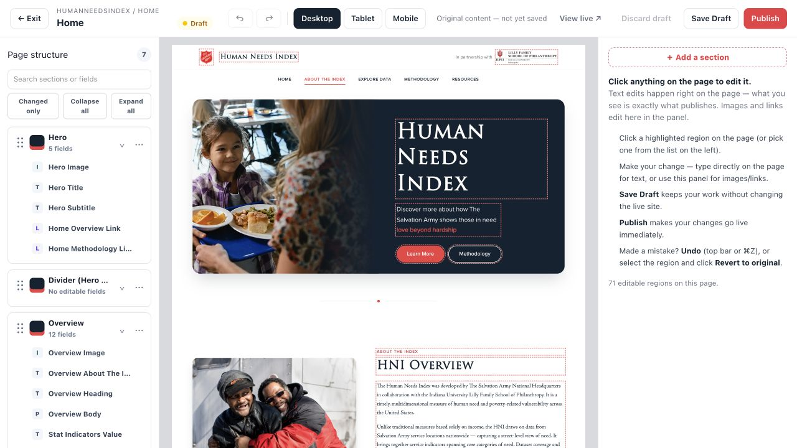

**Reference A — preserve the relationship between the three areas.** The page is the dominant work surface. The left outline gives orientation; the right panel changes with the selected field. Preserve the HNI design inside the canvas, including its photography, typography, partner identity and button treatment. CMS controls must not restyle the page.

The image is an actual V1 capture, not a proposed finished V2 screen. V2’s target geometry and controls are specified in §§6.4 and 7. Improvements should make this experience clearer and roomier. A dashboard-like form replacing the visual canvas is unacceptable.

### 1.3 Visual anchor: calm application shell

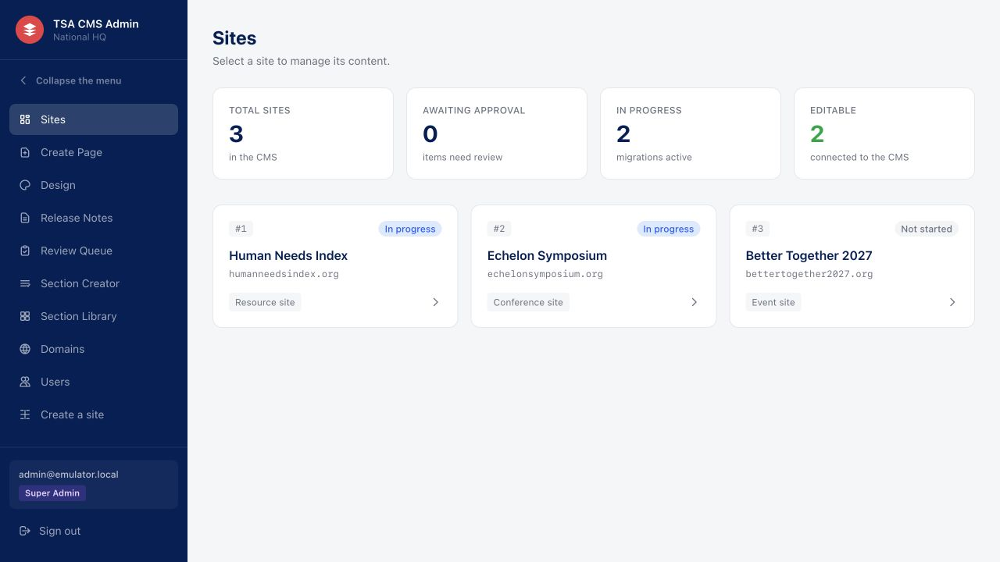

**Reference B — preserve hierarchy and restraint.** Use a dark navy navigation rail, a light workspace, clear headings and simple cards. Show the current site and task. Reserve prominent color for the primary action and meaningful status. Dashboard totals must derive from real data; empty counts must not suggest work has been completed.

### 1.4 Users and representative sites

The ordinary author understands content, not HTML, schemas or deployments. They must be able to change text and images, build a page from sections, manage speakers/resources, preview mobile output and request publication. Reviewers need exact changes and scope. Technical administrators need governed authoring and reusable components. Operators need reproducible startup and recovery.

Use these representative sites throughout acceptance:

- **Human Needs Index (HNI):** Home, Explore Data, Methodology and Resources; source-specific header with optional partner identity, multi-page navigation, footer/contact behavior, formatted prose, graphics and documents. Explore Data includes the actual data interaction or an explicitly approved retained application; a static chart is not a substitute.
- **Echelon Symposium:** full event page, source hero and branding, speakers, agenda/timeline, resources, sponsor/partner treatment and registration behavior. Test both a populated event and an honest coming-soon state. Never invent real event dates, rosters or destinations.
- **New resource and event sites:** created from archetypes in the CMS, with no site-specific repository or manual deployment required to edit them. Other sites follow only after these cases pass.

## 2. Scope and constraints

### 2.1 Required for the local product

Site/page creation; visual editing; responsive section composition; inline plain and supported rich text; images/links/icons; reusable section definitions and page recipes; code-to-editable-section organization; deliberate version upgrades and layout replacement; design/header/footer/navigation workspaces; collections and resource documents; media/font handling; roles/review/comments; readiness/publication/selected releases; enabled local scheduling; history/recovery; content transfer; source migration; accessibility and realistic walkthroughs.

A feature that exists but cannot complete its normal journey does not satisfy this scope. Broken or permanently empty tabs are not acceptable placeholders.

### 2.2 Conditional hosted release

Hosted identity/mail/storage, continuously monitored background execution, verified domains/certificates, backups/alerts and organizational handover are required before live operation. They do not block independent local UX work. A provider-dependent action is unavailable with a useful explanation until its capability and health are verified.

### 2.3 Outside this release

Unrestricted per-element/freeform layout; separate page orders for each device; arbitrary user JavaScript or plugin marketplace; full phone-sized CMS authoring; multi-language authoring; custom password/2FA implementation; external-domain canonicals; an analytics product; ticketing, booth allocation, learning management or AI article generation; rewriting unrelated source applications. Existing special applications must still receive an explicit migrate/adapt/retain disposition.

### 2.4 Non-negotiable constraints

- V1 remains independent and unchanged. No Firestore/Postgres dual-write or live cutover as a development prerequisite.
- Public pages contain useful complete HTML without JavaScript. Application-owned enhancement may support declared interactions; ordinary navigation and content cannot depend on it. No third-party script/font CDN at runtime; use device-native or self-hosted fonts/assets.
- Both CMS and public output target WCAG 2.1 AA. Do not compromise authorization, escaping or tenant isolation to achieve visual fidelity.
- Preview and public output share the renderer and content policy. Source-site appearance is retained through faithful definitions and assets, not by bypassing the renderer.
- Every offered control has a supported effect. Explain unavailable capabilities and unsupported imports precisely.
- Development, CI and deployment use the repository’s pinned runtime. Core persistence and recovery remain portable.

## 3. Architecture

Keep the existing TypeScript/Next.js monorepo, Postgres commands/RLS and shared renderer. Use React server rendering where useful; React component boundaries are not authorization boundaries.

| Area | Responsibility |
| --- | --- |
| `apps/admin` | Session-aware CMS and authorized same-origin draft preview. |
| `apps/site` | Public SSR, resolving verified site hosts/routes and published projections only. |
| `apps/worker` | Outbox jobs, schedules, image/thumbnail work, retries, heartbeat and health. |
| `packages/schema` | Hand-written SQL migrations, constraints/grants/RLS/commands, Drizzle types and Zod content schemas. |
| `packages/domain` | Framework-independent authorization, versioning, readiness and publication rules. |
| `packages/renderer` | Checked definitions, typed rendering, scoped CSS, metadata and editor instrumentation. |
| `packages/platform` | Role-scoped DB clients and auth/storage/mail/domain/cache/clock adapters. |
| `packages/seeds`, `e2e` | Deterministic fixtures and real database/browser/public-HTTP acceptance. |

**Runtime:** Node 24, repository-pinned pnpm 11, Postgres 15+ with Postgres 16 as the current local reference. Treat lockfiles and runtime declarations as authoritative for reproducible installation. Public database access is a narrow published-projection API; ordinary requests never use a service credential to bypass RLS.

**Rendering:** page and component previews use the same compiler, fonts/assets and renderer as public output. Admin preview is same-origin and authenticated; it does not edit a production site inside an iframe. Preview-only selection/insertion markers must not alter CSS selector behavior, layout, accessibility semantics or published HTML.

**Background work:** Postgres outbox and scheduled actions are durable, leased and idempotent. Support long-running worker and monitored drain execution. No hidden HTTP timer substitutes for durable scheduling. Provider failures remain visible and recoverable.

**Portability:** ship an OCI artifact with explicit admin, site, worker, migrate and drain roles. Keep authentication, object storage, domain provisioning, mail and cache invalidation behind adapters. A local fixture must run without hosted-provider access. A hosted configuration must reject local-test credentials/adapters.

## 4. Permissions

### 4.1 Product roles — selected target

Roles are assigned per site except Super Admin. No logged-in user gains site access merely by existing in the authentication provider.

| Capability | Contributor | Editor | Site Admin | Super Admin |
| --- | --- | --- | --- | --- |
| Inspect assigned site; edit existing page/record drafts; use permitted media | Yes | Yes | Yes | Yes |
| Submit for review; scoped comments/custom requests | Yes | Yes | Yes | Yes |
| Create/manage pages; publish ordinary content; approve/reject | No | Yes | Yes | Yes |
| Edit/publish navigation and shared header/footer content | Inspect | Yes | Yes | Yes |
| Manage site settings, design and collection schema | Inspect allowed views | Inspect | Yes | Yes |
| Create/revise site-owned definitions with bounded visual controls | No | No | Yes | Yes |
| Save/use/manage site page recipes | Use | Yes | Yes | Yes |
| Author advanced HTML/CSS/JSON source; shared or frame definitions; shared recipes | No | No | No | Yes |
| Approve/publish raw-code content | No | No | No | Yes |
| Create/import/archive sites; domains; users/memberships; shared media administration | No | No | No | Yes |
| Export a private site content archive | No | No | Yes | Yes |

Contributor “Use” for a recipe means inserting its sections into an existing editable draft; it never grants page creation.

**Decision:** advanced source authoring belongs to Super Admin; Site Admin retains useful safe visual authoring. This is the target chosen under the maintainer’s delegated engineering authority. Existing V2 grants that permit Site Admin source editing must be migrated and tested; this document does not claim they already match. Existing content and immutable definition pins remain readable/renderable. An upgrade must not rewrite existing content to enforce the new role boundary.

### 4.2 Enforcement

Resolve identity before rendering personal admin data. Every request rechecks active product-user status and site membership. Deactivation and membership changes apply on the next request. UI hiding is convenience; commands, database grants and RLS enforce the decision.

Database identities are authenticated user, public renderer, worker and migration owner. Workflow-sensitive mutations use narrow commands. The migration owner is never a runtime fallback. A command derives its actor from verified context, checks site ownership and expected version, then writes mutation, immutable references, audit and outbox atomically. Test unauthenticated, foreign-site, insufficient-role, disabled, stale and allowed cases as real database roles.

## 5. Content and state model

### 5.1 Vocabulary that authors can understand

| Term | Meaning and independence |
| --- | --- |
| Site | A public website, its pages, design, shared elements, content and access assignments. |
| Page | Addressable content assembled from ordered section instances. |
| Section definition | Reusable layout and typed fields, with immutable versions. “Text + image” describes the layout, not one page’s story. |
| Section instance | A page’s own values, label, visibility and pinned definition version. Editing it does not edit other uses. |
| Page recipe | An ordered starting composition pinned to section versions, with safe sample/default values. Insertion copies independent instances. |
| Shared header/footer | Site-wide component instances. Their content is separate from both reusable definitions and page sections. |
| Collection | Repeating records with a stable reader key and a versioned schema, such as speakers or resources. |
| Saved draft | A server-acknowledged private version. Saving is not publishing. |
| Published version | The immutable content intentionally available to visitors. |
| Release | An exact selected set of page and shared-artifact versions published together. |

### 5.2 Persistence invariants

A mutable head owns identity/revision and draft/published pointers. Immutable versions own content. Every tenant-owned record and reference is site-consistent through constraints and commands. Structured payloads have validation and size limits in both application and database.

Every save includes the loaded revision. A stale save returns a typed conflict while retaining local work; never silently overwrite the newer head. Checkpoints, submissions, publishes, schedule pins and referenced history are retained. Unreferenced rolling autosaves alone are eligible for policy-controlled pruning.

Publishing changes the appropriate public pointers and compact public-safe route/shell projections in the same transaction as audit/outbox. Public roles cannot reconstruct content from private authoring tables. Cache keys include tenant, host, path and published revision. Adapter failure after commit is reported as delivery/invalidation trouble, not misreported as an unsaved draft.

### 5.3 Preview contexts

| Context | Includes | Does not imply |
| --- | --- | --- |
| Current page draft | Local page edits plus the explicitly selected appearance context | Publication or inclusion of unsaved work in other tabs. |
| Published appearance | Published theme, navigation and frame; appropriate published collection data | Current shared drafts. |
| Saved appearance | Saved draft theme, navigation and frame; registered authorized fonts/assets | Unpublished collection records or another tab’s unsaved changes. |
| Component sample | Clearly labeled samples in the chosen site appearance | A saved page or actual collection record. |
| Release preview | Only the authorized exact versions selected in the release plan | All drafts in the database. |

Each preview names its context. A failed refresh cannot display an old render as if it represented the new selection.

## 6. Product workflows

Each subsection specifies desired behavior, not implementation status. The coverage codes are stable tags used in commit messages and history.

### 6.1 Sign-in and access

Use email-link authentication; no application password fields. Super Admin invitations establish the product user, role and assignments before delivery. Accepting the link attaches the verified identity. Delivery errors are visible and retryable without duplicate users. Authenticated-but-unassigned users receive a clear no-access screen without tenant data. Microsoft identity stays unavailable until an organization supplies its tenant and responsible owner. The first organizational pilot is scoped to national/NHQ users with explicit site assignments; a wider territorial rollout is a separate organizational decision.

**Accept:** an invited contributor sees only assigned sites; changing assignments/deactivating takes effect on the next request, including an already-open session. Login has no flash of unauthorized content. Link expiry, retry, missing membership and denied access have clear recovery. **Coverage: AUTH-01–AUTH-04.**

### 6.2 Sites and guided creation

The Sites screen lists authorized sites with name, address, kind and real status. A site workspace provides Pages, Header & footer, Navigation, Design, Content, Media, Publishing, Activity and Settings according to role. Advanced owner tools stay out of ordinary editorial tasks.

Create a site through five steps:

1. **Name:** name, short address, resource/event archetype and description. Validate uniqueness without losing entered values.
2. **Look:** brand color, supported type pairing and button shape beside a live example.
3. **Pages:** choose a useful recipe or blank composition, name pages, edit addresses/order/nesting and menu inclusion.
4. **Header & footer:** choose supported starting designs, optional partner identity and shared links. Explain that they affect every page.
5. **Review:** show name, address, look, page outline and next step. State that creation produces private drafts.

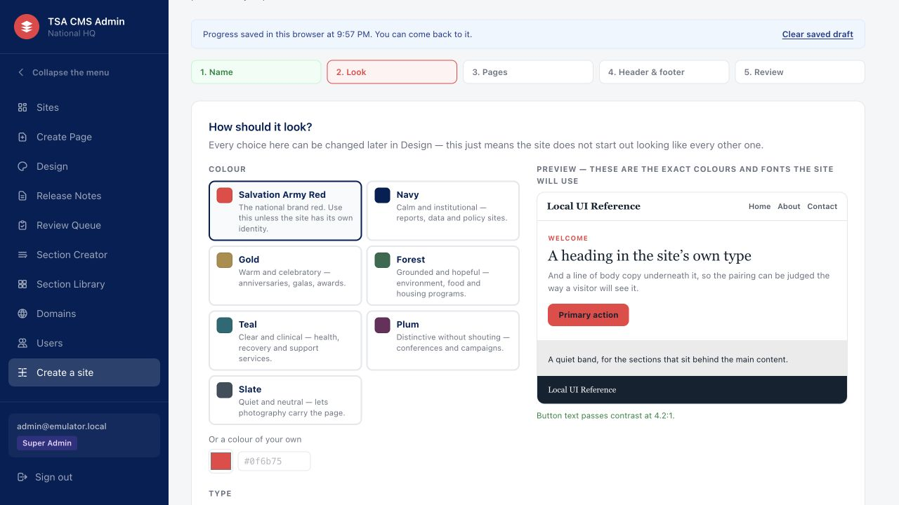

**Reference C:** show the effect of a choice while making it. Correct V1’s inconsistent contrast verdict; do not copy its “passes at 4.2:1” message for ordinary-size button labels.

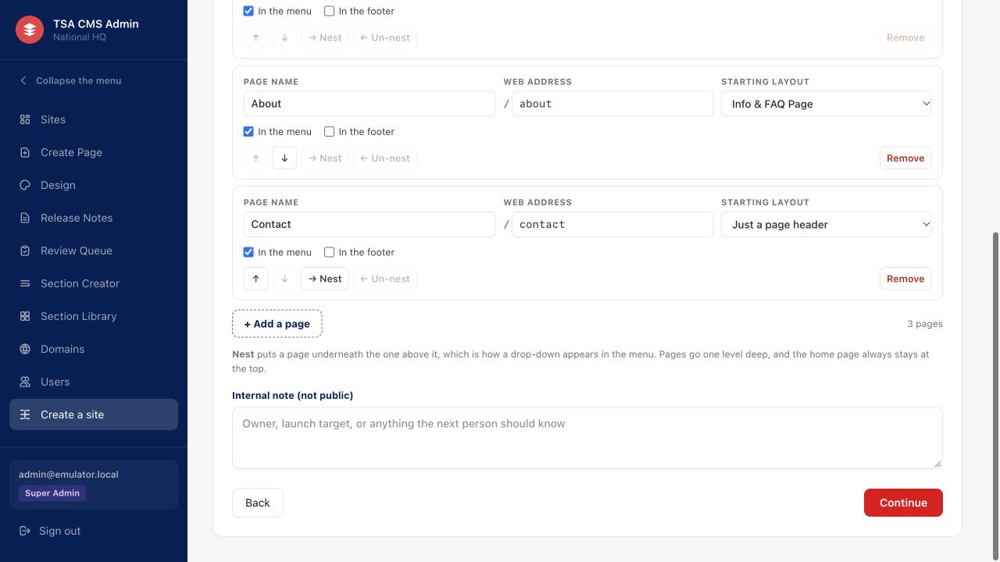

**Reference D:** plan actual pages, not a site name followed by an empty shell. Back/Next retain inputs. Errors identify the field and preserve the plan. A repeated Create request creates one site. Creation and initial draft content succeed together or leave no half-created site.

**Privacy decision:** creating a site does not publish seeded pages. An authenticated private preview must work immediately. A staging URL/route can be allocated, but unpublished pages remain unavailable to anonymous visitors. After deliberate publication, staging output remains `noindex`. `noindex` is not access control.

Distinguish importing a wizard setup plan from importing a full content archive. Archive a site through a scoped confirmation; public access becomes 404 while authorized inspection/recovery remains available. **Coverage: SITE-01, SITE-02, PORT-01.**

### 6.3 Pages, addresses and history

Add page offers a starter recipe, blank page or custom initial section composition. Before creation, the author can add/remove/reorder sections and see the intended address. Resolve active definitions server-side; creation of page and initial immutable version is atomic. Open the resulting page in the same visual editor used for existing pages, with the page title in the appropriate initial heading.

Use clear page cards/table rows with title, address, state and relevant action. Rename must distinguish display title from public address; validate collisions and reserved live addresses. Archive/unpublish explains effects on links/navigation. Never leave live menu links pointing to an archived page. Removing a menu item alone never removes a page.

History shows actor, time, meaningful action and saved/published distinction. Compare versions with rendered and field differences. Capture a named checkpoint before consequential upgrades. Restore creates a **new draft**, including the correct content/title/address according to validated restore policy; it does not silently move live state backward.

**Accept:** create a three-section composition and retain its exact order; stale save retains local work; archive repairs/rejects affected live navigation safely; restore an older publication as a draft while visitors continue seeing the current publication. **Coverage: EDIT-07–EDIT-11, SITE-02.**

### 6.4 Visual page editing

#### Layout and orientation

At desktop widths, show the outline, rendered page and inspector together. The top toolbar contains Exit/breadcrumb/title, content state, Undo/Redo, visitor viewport controls, save status, Preview, Save draft and the role-appropriate Publish/Submit action. Separate saved state from public state. Advanced or infrequent actions belong in a labeled secondary menu.

The outline groups sections and their human-readable typed fields. Include search, Changed only, Collapse/Expand, rename instance, and section count. Instance labels describe the page (“Spring appeal”), while the library retains the generic layout name. Changed markers compare actual values against the session-opening acknowledged checkpoint, not the existence of stored overrides or the newest autosave. Autosaving must not erase the useful record of what the author changed during the session.

Canvas click and outline click select the same stable section/field, scroll it into view and show matching inspector values. Use section boundary plus field boundary and a textual selection label; color alone is insufficient. Escape leaves text editing/selection predictably. A selected item remains identifiable after moving, hiding, undoing, saving and reopening.

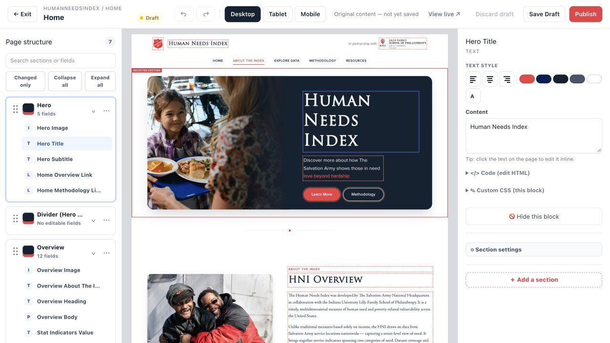

**Reference E:** the author can tell what will change before typing. Preserve the connection among canvas, outline and inspector.

#### Text and rich text

The first click selects a field; a subsequent click inside editable text places the caret at the clicked position. Keyboard users can activate editing from the selected field. Plain text edits on the page and in Content synchronize without selection jumps.

Supported rich-text fields also support direct canvas editing and a full visual inspector editor. Both edit the same structured content. Provide headings 2–4, paragraphs, bold/italic, lists, quotes, safe links, supported alignment/color, undo and normalized paste. Do not expose H1 formatting for body text when the page already supplies its title. Preserve valid inline emphasis, links, formatting and source order on load/save. Do not fragment one paragraph into dozens of unrelated fields or flatten styled text into plain strings.

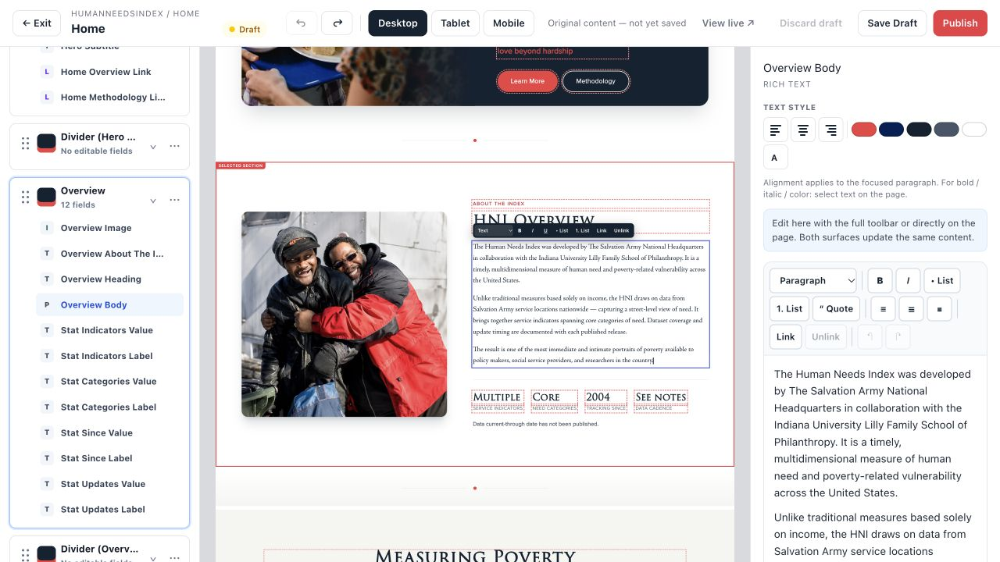

**Reference F:** inspector-only formatted editing is an interim V2 limitation, not the target. Use an established structured rich-text editing engine and a shared model; avoid independent ad-hoc contenteditable implementations. Unsupported source boundaries remain explicit and repairable. Raw HTML is a separate governed technical surface.

#### Contextual fields and section controls

- **Image:** current preview, upload/choose/replace, alt text or explicit decorative intent, focal point where supported; show processing/readiness and preserve selection through picker cancellation/reopen. Replacement does not alter other uses.
- **Link/button:** readable label, page/anchor/destination picker, safe external URL, new-tab/nofollow, supported fill/outline/text style, semantic color, size, weight, full width and supported hover treatment. Preserve query strings and anchors. Explain unsupported source styling; no decorative controls that do nothing.
- **Icon:** visual choice from the permitted vocabulary, with a safe faithful source mapping where required. Do not substitute arbitrary stock symbols for distinctive source icons.
- **Section:** private label, move, duplicate, hide/reveal, delete, allowed width/spacing/alignment/mobile size and Change layout. Hidden draft sections remain selectable and editable with an explicit badge. Globally hidden sections are omitted from public HTML. Breakpoint visibility is responsive presentation in the shared SSR document, not confidentiality; it must not be advertised as removing sensitive content. Editor-only reveal never reaches public output.
- **Advanced source/CSS:** Super Admin only, collapsed by default, with explicit review/publication consequences. Parse/scope/validate it and preserve typed editing. There is no arbitrary-script escape hatch.

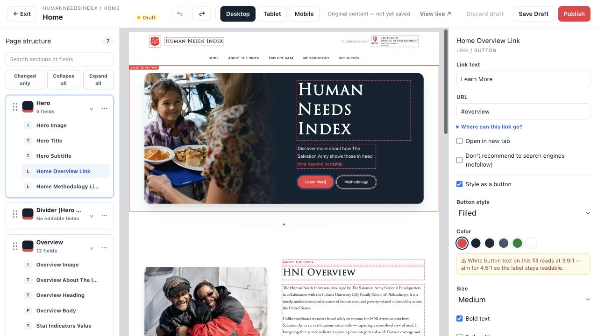

**Reference G:** use task-specific controls and practical feedback. Contrast is evaluated against the resolved background; a theme swatch alone does not prove readability on a photo or gradient.

#### Add, move and change layout

Add a section opens a **docked shelf in the inspector area**, leaving the page and structure visible. Show search/category chips, site-themed thumbnails, favorites, recipes and Request custom. At tablet widths use the auxiliary editor pane described in §7. A full-size detail preview may be modal; the browsing shelf must not become a full-screen catalog that hides insertion context.

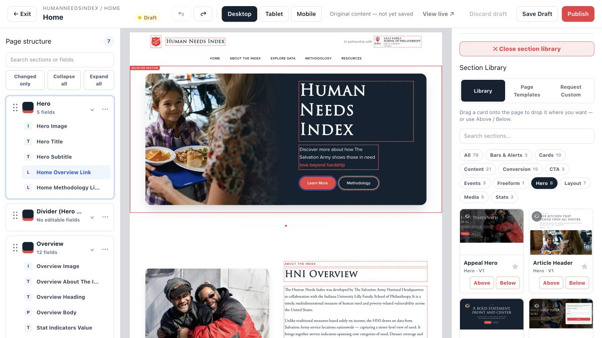

**Reference H:** every add action states its destination (“Below Overview”); pointer users can drag to visible gaps, while keyboard users have equivalent explicit insertion and move controls. Commit inserts one independent instance, closes the shelf and selects/scrolls to it. Duplicate copies values into new instance identities. Move preserves content and selection.

**Change layout** selects a different definition; **Update available** selects a newer version of the same definition. Both preview mapped values, identify new/removed/incompatible fields, retain the original in a checkpoint, and require deliberate application to the selected draft instance. Never silently overwrite incompatible values or update every use.

#### Responsive editing

Desktop/Tablet/Phone controls change the **visitor viewport**, not the content model or the CMS layout. Defaults are 1280/768/390 CSS pixels, with displayed actual width and zoom. Scale-to-fit must preserve that viewport’s layout; it must not reflow desktop content to the physical width of the center column. Coordinate mapping, caret, focus and insertion remain correct under scaling.

Use one ordered page. Bounded responsive controls are supported section/node visibility, source-supported Mobile size and phone reversal of an eligible two-column group. No independent per-phone page sequence or arbitrary per-breakpoint styling. Normal edits must work responsively without a second layout exercise.

#### Save, undo and recovery

Autosave creates acknowledged private versions; Save draft flushes pending work. Show `Unsaved changes → Saving… → Saved`, with `Save failed`, `Offline` or `Conflict` as real states. Never display Saved on a timer or merely after dispatch. Opening/reading an existing item must not mark it dirty.

Undo/Redo cover typing, field/style changes and structural operations. Native input/dialog undo operates on that input, not an unrelated page command. The session-opening acknowledged checkpoint is the fixed baseline for Changed only, per-field revert and Revert this session. The latest acknowledged snapshot is the separate baseline for Saved/Unsaved status. Label the whole-session action “Revert this session,” identify its opening checkpoint, and explain that autosaved changes are reversed by creating a new draft, not deleting history. Retain that opening checkpoint while recovery/session state depends on it. Restore from published is a distinct action. Live content is unchanged until publication.

Guard departure through sidebar, breadcrumbs, internal links, Back/Forward, reload/close and redirects while work is unsaved/pending/failed. Cancel preserves work. Save-and-leave waits for acknowledgement. An interrupted session offers recovery scoped to the same user/site/page/base version; it must not leak a draft to another account. A conflict offers compare/reapply/cancel with local input intact. Do not promise browser-persistent recovery until that path is implemented and tested.

**Accept:** select and directly edit the HNI heading, observe the inspector synchronize, undo, redo, save, reload and verify; repeat with rich-text formatting and safe paste. Insert between named sections, move/hide/duplicate, undo deletion with content intact. Simulate offline save, navigation and two-editor conflict without silent loss. **Coverage: EDIT-01–EDIT-12, LIB-10–LIB-11, FID-08.**

### 6.5 Section library, creator and page recipes

The full library offers category/search/scope/site filters, favorites, real usage links and honest source/compatibility labels. Cards show faithful pre-rendered thumbnails in the selected site’s brand. Generate thumbnails asynchronously; show processing/failure/retry rather than an unrelated generic image. Do not mount a live iframe in every resting card.

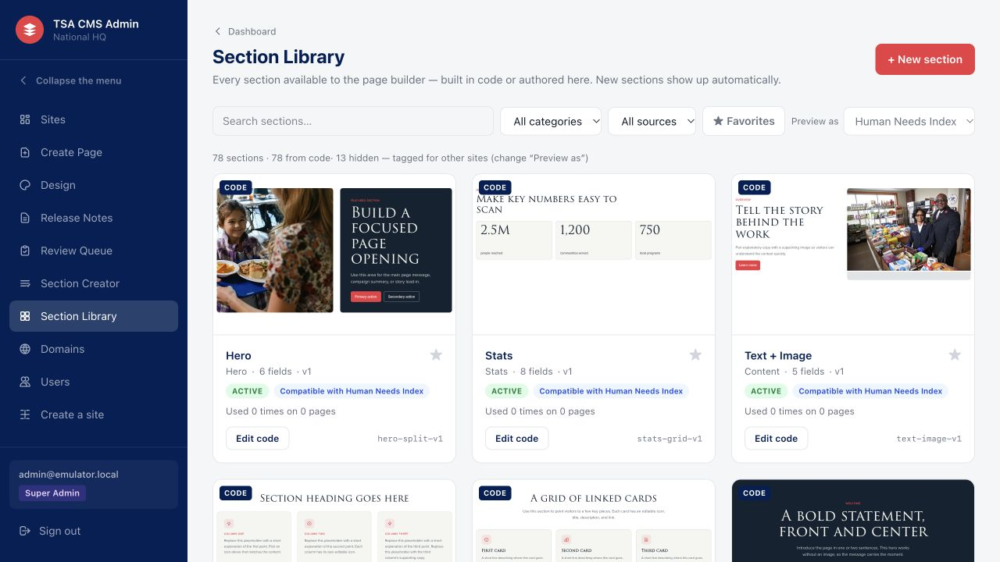

**Reference I:** an author recognizes a layout visually before choosing it. The same shared section previews correctly in HNI and Echelon, including their fonts. The page-specific instance label never replaces the reusable library name.

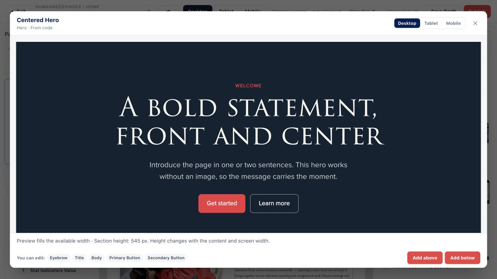

**Reference J:** detail preview shows readable actual output, editable fields, compatibility and insertion action. It must use the chosen appearance context. A text-only catalog or placeholder picture cannot satisfy this requirement.

**Visual creator:** Site Admin can create/revise a site-owned definition through bounded layout and typed-field controls. Super Admin can also author source and shared/header/footer definitions. Use one creator for create and edit. Require name, category, scope, placement, compatibility, stable field IDs, preview and a meaningful change note before creating a new immutable definition version. Keep input after validation/save failure and focus the implicated field.

**Source organization:** accept a bounded HTML/CSS section fragment, including a supported inline style block. “Organize into blocks” parses and separates HTML/CSS, proposes stable typed fields and labels, repairs duplicate IDs and their references consistently, and shows unsupported regions for manual correction. Preserve original source for comparison. Never destructively re-tag existing deliberate fields or equate manual token entry with this capability. Preview confirmation is required for the exact source, schema and styles being saved; any change invalidates that confirmation, and the server still recompiles. Arbitrary complete websites, active scripts and ungoverned network/form behavior are not supported input.

**Version/lifecycle:** store authored source separately from checked compiled output and policy versions. New saves create a version; placed instances remain pinned. Show update availability and value-preserving before/after review. Deprecation prevents new use while retained pins still render. Usage/dependency checks protect deletion. Supported repeat families have actual item schemas, stable keys and add/remove/order editors; placeholder output is insufficient.

**Page recipes are included:** Editor+ may save an ordered composition as a named site recipe; Super Admin controls global starters. Let the author explicitly choose reusable sample content. Exclude page address, SEO/publication state, private records and operational history. Pin definitions and validate assets/bindings. Using a recipe creates independent draft instances; editing the recipe does not change existing pages. Reusing across sites requires permitted media and deliberate binding remapping. Provide preview, rename/update and retirement with existing pages unaffected.

**Request custom:** contributors can explain the needed section, supply context and track an owner response. The request stays scoped, supports close/reopen with notes, and does not send external notifications unless that channel is explicitly configured and enabled.

**Acceptance:** create a safe definition visually and from organized source; save version 2 without changing a page pinned to version 1; preview/apply one upgrade, then have an ordinary editor change its supported text/image/link visually and save/reload without losing existing content; swap one instance’s layout with recoverable content; save/use a recipe to create independent drafts; show one shared module in both brands. Account for every inventoried V1 definition with a faithful mapping or explicit approved disposition. **Coverage: LIB-01–LIB-11.**

### 6.6 Design and branding

Design controls site colors, typography, supported button treatment, spacing and shared visual rules. Use semantic tokens with a preview of an actual selected page and visitor-width controls. Also retain a small clearly labeled token example when useful. Fonts are registered authorized self-hosted assets or device-native stacks.

Show only controls supported by the site’s sections, with usage notes where support is partial (“Added sections only”). Do not imply that changing a token overrides intentionally authored source CSS. Distinguish site theme, section overrides and field/button overrides; show the winning value and provide Reset to inherited. Per-site advanced CSS is Super Admin-only, parsed/scoped to that site’s rendered content, versioned and reviewed before publication. It must never style the CMS or another site.

Saving/reverting makes a private version. Publishing Design explicitly affects all pages of that site, after contrast/readiness checks. Revert from live creates a new draft. Colors, fonts and spacing must agree across page, frame, library, creator, upgrade and release previews.

**Accept:** preview an accent/font change on two real pages, save privately, then publish only that site. A failing resolved contrast pair is explained and blocked unless an allowed, recorded override applies. Unsupported controls are absent or honestly unavailable. **Coverage: SITE-03, SITE-07, MEDIA-06, QA-03.**

### 6.7 Header, footer and navigation

Header & footer is a separate site-wide workspace. Show an unmistakable “Applies to all N pages” notice, a selected real-page preview and separate controls for each component. Support built-in presets **and authored frame definitions**. Migration must use authored components when a preset would alter the original composition.

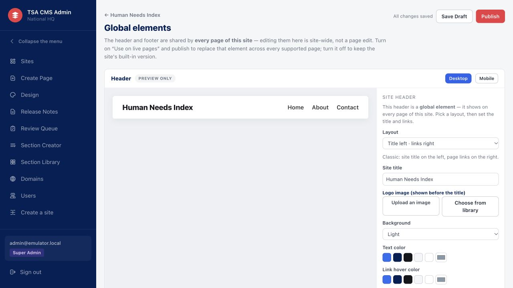

**Reference K:** preserve explicit scope and preview. This V1 screenshot has default emulator data, not the complete target header or a requirement to replace HNI’s partner-branded frame with a generic title.

Switching built-in/authored modes preserves each mode’s local draft; re-clicking the selected mode is a no-op. A confirmed saved-version refresh clears stale alternate caches. Definition changes and instance content remain separate. Save/Publish/Revert treat the header/footer pair atomically; a failure cannot leave mismatched live halves.

Support logo/full-compact identity, optional partner/presenter identity, intended sticky behavior, utility links, CTA, footer link groups, contact information/disclosure, legal/social links and shared Salvation Army foundation. Foundation removal requires Super Admin. Images/fonts must be ready and authorized. Never move a partner logo or contact interaction into an unrelated page section merely to avoid implementing its frame placement.

Navigation owns the main menu; Design owns theme; Media owns assets. Link to those workspaces instead of maintaining competing copies. Navigation has automatic/manual modes, stable labels/order/one-level dropdown nesting, hide/reveal and safe internal/external/anchor destinations. Automatic mode adds eligible published pages and preserves deliberate ordering, labels and nesting on republish. Manual mode adds nothing silently. Removing a menu item does not unpublish the page. Unpublished page links work only in authorized preview; live readiness refuses unavailable internal targets.

Desktop hover, keyboard focus and touch/mobile disclosure must work. Menus do not navigate while the author is selecting editable fields. Public menus use accessible semantics, correct focus and native/scriptless behavior where feasible.

**Accept:** edit shared content and inspect two affected pages; preserve both mode drafts; cancel and recover; publish the pair once; verify HNI partner/navigation/contact and Echelon frame at each visitor size. **Coverage: SITE-04–SITE-07, FID-06.**

### 6.8 Publishing, SEO, releases and scheduling

**One policy:** page Publish, review approval, selected releases, recovery publication and scheduler execution use the same domain/DB boundary. Reauthorize, compare revisions, validate pinned dependencies, recompute trusted-code status and readiness, then commit pointers/projections/audit/outbox together. Import never publishes automatically.

**Readiness:** group blocking and advisory findings by item, explain the consequence and take the author to the affected field. Block rendering failure, missing required heading, unavailable/foreign/unready media, missing image alternative/decorative intent, broken governed internal links, invalid canonical, unapproved trusted code and failed required contrast. Metadata completeness follows declared site policy. Only explicitly overridable findings permit an actor/reason/policy-bound exception; authorization and tenant/content safety cannot be overridden. New findings invalidate old exception consent.

**Public output:** return complete semantic HTML, title fallback, description/social metadata, canonical, robots, sitemap and supported JSON-LD. Internal/external/query/anchor URLs retain meaning. Unknown hosts, unpublished and archived routes return neutral 404s. Preserve correct old-address behavior and intentional redirects, with no foreign-tenant fallback. Staging remains `noindex`; private preview is authenticated and `no-store`.

**Canonical rule:** relative URLs resolve to the same site’s verified primary HTTPS host; absolute canonicals must normalize to that same host. Normalize case, default port, trailing dot and IDNA with a URL parser. Reject credentials, non-default ports, malformed/protocol-relative/backslash-authority or unsafe schemes and foreign hosts. Render a safe own-page fallback on refusal and block publication with a redacted explanation. Staging and aliases name the verified primary URL. Cross-domain canonical is out of scope.

**Publish together:** when the only thing holding a page back is links to pages of the same site that are not live yet, or the site has never been published, Publish names what has to go live with it — those pages (following their links in turn), the content lists they show and, the first time, the site's design, header, footer and menu — and publishes them as one release on confirmation. A link to a page that does not exist still blocks.

**Selected release:** show the exact versions of selected pages, frame, theme, navigation, collection schemas/records and settings, with dependencies and scope. Combined preview uses that immutable plan. Publishing is all-or-nothing within an explicitly supported size limit; an oversized plan is refused before mutation. No silent chunking into partial success. Stale plans require re-planning; retrying an applied request returns the original receipt.

**Coordinated recovery is included:** select an applied release and choose “Recover the state before this release.” Its receipt must retain pre-apply version references and explicit previously-unpublished markers for every affected item. Review exactly those affected items, preserve any later drafts through checkpoints, create coordinated recovery drafts plus explicit unpublish intentions where appropriate, then preview and execute through the ordinary atomic release flow. A newly published page becomes unpublished rather than deleted. Changed heads require review/CAS; intervening history remains recoverable. Missing assets, retired-but-unresolvable pins or failed permission/readiness leave live state untouched and identify the blocker. This restores the selected release’s affected items, not unrelated later work or an entire site by implication. No immediate pointer-rewind shortcut.

**Scheduling:** display the author’s time zone and an unambiguous stored instant. Handle DST ambiguity explicitly. Pin action/item/version/creator/readiness policy. Validate both at creation and execution, including current user/site permission and media/readiness. Later drafts do not silently join a schedule. Unpublish must not remove a different newly published version. Serialize cancellation/execution; retain terminal failures and linked retry attempts. Policy upgrades carry pending pins forward through an audited migration. Enable creation only with a healthy worker/drain and independently verified monitoring; keep past queue/error history visible if scheduling becomes unavailable.

**Accept:** the same invalid draft fails from editor/review/release/scheduler; concurrent publish yields one success and one recoverable conflict; selected release changes all intended artifacts or none; recovery leaves live state alone until normal publication; a healthy due schedule executes once and revoked access makes it fail closed. **Coverage: PUB-01, PUB-03–PUB-07, DB-02–DB-04.**

### 6.9 Collections, event content and resources

The complete event workflow is a primary acceptance case: an editor must maintain speakers, agenda and registration links without a developer. Prove reuse with two conference drafts from the same event recipe and a next-year revision: change name/year, logo/colors, speakers, agenda and registration destinations through supported editing, without source changes. Each conference retains independent content and branding; revising a draft does not alter another conference or an existing publication. Labeled placeholder content is acceptable for this test. Automatic annual cloning is not required. Echelon is not merely a second visual sample. HNI remains the maintainer’s first visual-editing benchmark.

Provide familiar record editors: labels, formatted descriptions, images, dates/times, links, ordering and archive/restore. Built-in event/resource models and permitted custom models use the same underlying system. Ordinary editors never enter JSON, object identifiers or schema expressions.

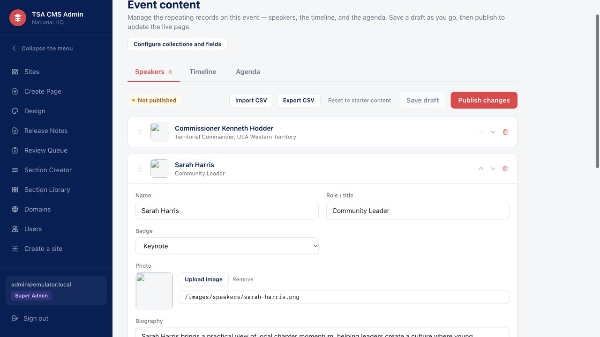

**Reference L:** opening a record reveals the fields needed for that task. Provide speaker/agenda/timeline starters and resource records with title, category, summary, image and download/link. Support repeated FAQ/cards/programs through appropriate item schemas, not hard-coded copies.

Collections have stable reader keys, versioned schemas and stable record keys. Sections bind to compatible same-site collections with supported automatic limits or explicit record order. Show sample versus published data honestly. Draft labels/new records cannot leak into an ordinary published-data preview.

Schema changes are deliberate: preview consequences of added/removed/type-changed fields, keep old record/schema pins resolvable, apply safe defaults and explain incompatible rows. Upgrade older simplified starters without losing keys, records or published content. A new template field must not silently empty a live list.

CSV import has mapping/dry run, row-level errors and confirmation. Handle Unicode, quoting, embedded line breaks, dates, URLs, blanks and duplicate/missing keys. A failed import changes nothing. Authorized export includes the schema/version needed to interpret it. Preserve accepted values and order in round trips.

**Accept:** add/edit/reorder/archive/restore a speaker and PDF resource, publish through the correct role, and see the intended live output; opening then leaving stays clean; picker cancel and async save do not duplicate rows or lose later input. Test long content and empty states with labeled fixtures; current real Echelon publication content still requires its approved export. **Coverage: COLL-01–COLL-08.**

### 6.10 Domains

Domains are a later hosted capability; local editor work must not wait for them. Only the global Super Admin role can add, verify, remove or change the primary domain, including direct command calls. Site Admins, Editors and Contributors may inspect addresses for assigned sites but cannot manage them. Super Admin adds a normalized hostname to a site, sees exact DNS instructions, checks verification and follows a visible `Pending DNS → Verifying → Certificate → Live/Error` progression. Retry displays the actual failing stage without exposing credentials. Automatic recheck is a durable job.

Select a verified primary host; aliases redirect consistently, including configured apex/www behavior. Path-based coexistence requires a router/proxy; DNS cannot assign a path to a different application. Trust forwarded headers only from configured proxies. Unknown hosts never fall back to a tenant. Removal revokes app routing before provider cleanup; failed cleanup remains visible and retryable. Confirm the hostname and consequence before removing it.

**Accept:** rehearse a genuinely authorized test domain end to end, including DNS, certificate, aliases/canonical, removal and retry. Manual provider steps must be explicitly documented and tested if the chosen $0 profile cannot automate them. A local recording adapter does not prove domain integration. **Coverage: OPS-01–OPS-03, AUTH-03.**

### 6.11 Images, documents and fonts

Use a site-scoped library plus a governed shared pool. Make All images, Unfiled and any folders/tags unambiguous. Offer search, previews, names, attribution/source, usage and permitted bulk actions. Pickers preserve selection through filtering, cancel/reopen and recoverable failures.

**Images:** validate actual MIME/decode/dimensions/bytes; signed upload grants are scoped by site/path/type/size. Show upload progress then processing/ready/rejected. Require alt text or explicit decorative intent, and support focal point/appropriate variants. Responsive output uses inspected renditions. Replacing creates a new immutable asset; references change only where the author deliberately chooses it. In-use/historical/shared references govern deletion; soft-delete and recovery cannot remove bytes still required by retained content. Physical cleanup is delayed and audited.

**Documents:** bounded PDF management is required: upload, preview metadata, search, optional category, select/link, replace and archive from future selection. Limit PDF upload to 25 MiB, with server-side validation as well as helpful form feedback. Replacement creates a new immutable receipt; selected draft references can be updated deliberately while live/history links remain valid. Archiving does not revoke bytes still referenced by published or retained versions. A document is not an image, and image delete commands cannot stand in for a PDF lifecycle. Do not claim malware scanning unless actually configured and verified. General office-document conversion/workflow is out of scope.

**Delivery/privacy:** private originals and documents require membership; public delivery requires an authorized rendered reference. Validate page, collection and authored-frame references, including CSS/static sinks. Reject foreign, missing, deleted or unready assets as appropriate. Historical bytes remain available to authorized historical previews; retained history alone does not make an asset anonymously public. Keep upload/retirement retries idempotent; abandoned transfers do not become public.

**Fonts:** register authorized self-hosted assets, deduplicate deterministically and include them in every relevant preview/public surface. Missing fonts produce an actionable finding, not a silent CDN replacement. Export/recovery retains image originals/variants, PDFs and referenced font bytes with checksums.

**Accept:** upload/select/replace a real image and PDF through the UI, handle invalid files/worker failure, preserve existing uses, verify public and private delivery as distinct roles, and restore supported archived metadata without breaking history. **Coverage: MEDIA-01–MEDIA-07.**

### 6.12 Review, comments and owner inbox

Contributor submits an immutable version. The reviewer sees that exact content and its differences, author, scope and readiness. Approve publishes the reviewed version once; if the relevant head changed, refuse with current-version context and retain the submission. Reject requires useful feedback visible when the author returns. Raw-code versions require Super Admin even when an ordinary reviewer could publish other content.

Comments and mentions are visible only to authorized participants. The maintainer inbox combines submissions, custom-section requests, domain errors and failed jobs, with truthful counts, filters and next actions. Close/reopen/acknowledge/retry meanings depend on the item; acknowledging an operational failure does not fix it. Do not automatically send external mail for every comment.

**Accept:** contributor cannot bypass review; stale approval cannot publish a newer unreviewed draft; rejection reaches the author; a custom request can be answered, closed and reopened; every action respects tenant scope. **Coverage: PUB-02, PUB-08, LIB-09.**

### 6.13 Activity and audit

Provide filterable site/person/action/date activity with stable pagination and clear actor types. Events include save/checkpoint, submit/review, publish/release/schedule, membership/domain/media changes, recovery, overrides and migration. Show meaningful summaries and immutable before/after references. Do not copy arbitrary content, secrets or credentials into log details. Account-directory access must not expand merely because a user can inspect site activity.

Audit is append-only to application roles and written in the same transaction as its state change. One successful command/retry receipt produces one logical transition, not duplicates. Preserve failure/retry history. **Coverage: PUB-08, DB-02, AUTH-04.**

### 6.14 Migration and content transfer

**V1 migration:** consume a read-only versioned export plus source definitions/assets. Record hashes, counts, source content revision, source page/definition pins, field labels, draft/live distinctions, release history, mappings and every unsupported dependency. Re-running a manifest is idempotent; failed import is atomic or explicitly journaled/recoverable. Never modify V1, fabricate missing records or hide unsupported content in empty sections.

Choose the captured per-site V1 appearance as the default local acceptance reference. If the same definition ID differs across sites, preserve separate site-scoped variants by default. Unify only after proving compatible semantics and appearance. Divergent code is not itself a reason to ask the maintainer to pick a winner. Source-vs-live content conflicts and deliberate design deviations need a concrete recorded disposition; production content needs authorized current data.

Reconcile all 118 entries in the existing source inventory. “Automatic,” “quarantined” and “manual” are importer classifications, not acceptance. Cover repeat families, SVG/icons, nested editable text, attributes/CSS, IDs/anchors, site variants and active applications. A faithful safe adaptation is acceptable; weakening the sanitizer or replacing an interaction with a screenshot is not.

**Site content archive:** export retained page/definition/frame/schema/record/theme/navigation/settings and page-recipe versions, their exact definition pins and referenced authorized media/font/document bytes. Preserve recipe asset references and deliberately remap collection bindings in the new site. Import into a separate private site, allocate/remap IDs, recompile source under current policy, clear live pointers/approvals and keep source versions editable. Include scope and privacy warnings. Do not transfer accounts, grants, credentials, DNS bindings, jobs, review conversations or operational audit as if they were page content. Preserve external URLs without fetching them. This transfer is not a full database backup.

**Existing websites:** an ordinary existing site joins the CMS by importing its built pages, stylesheets and files ([ADR 0011](../adr/0011-connecting-existing-sites.md), `pnpm import:website`): the shared header and footer become the site frame, each content block becomes a site-scoped section that keeps its own HTML and the CSS that applies to it, editable fields come from V1-style `data-cms-*` tags or proposed ones, and files become media and documents. The result is a private draft site plus a report of everything not carried over (scripts, forms, remote files, licensed fonts, pages without a main heading). Applications that must stay separate read published content instead.

**Vendor integration boundary:** retain a clean renderer/output seam for a separately scoped vendor adapter. A V2 content archive is not vendor-compatible HTML. Any fragment export must declare its CSS, assets, link rewriting and dynamic collection dependencies and be verified in the destination CMS. Vendor-native blocks remain preferable for work already assigned to that CMS; a companion HTML editor is a conditional fallback, not an implied replacement of Zesty or a promise of arbitrary copy/paste portability.

**Accept:** HNI’s four pages and Echelon’s complete page retain source content, structure and interactions at matched widths; each inventory entry has a justified disposition; repeated imports do not duplicate; archive round trip preserves semantic content, exact pins and bytes while creating a new private site. **Coverage: BASE-01–BASE-02, FID-01–FID-09, LIB-01–LIB-05, PORT-01–PORT-02.**

### 6.15 Recovery and operator handover

Back up database **and** media. Rehearse restoration into isolation, with historical workers/schedules disabled until reviewed. Verify constraints, role boundaries, immutable pins, a published page and image/PDF/font delivery. Record measured recovery time and recoverable data age; a successful backup command is not a restore test.

A new operator must be able to start the system, identify running versions, inspect worker/backups/errors, restore it and verify output without private verbal instructions. Production migrations have tested clean/upgrade paths and a restore/roll-forward plan. Never reset a review/source database as a test fixture. **Coverage: DB-01–DB-04, PORT-03–PORT-04, OPS-04–OPS-06.**

## 7. Visual and interaction standards

These are selected V2 design defaults, grounded in the V1 examples. They guide implementation without asking a newcomer to invent an unrelated aesthetic. They are not claims about current CSS.

### 7.1 Application design system

| Element | Target |
| --- | --- |
| Navigation | Deep navy `#0D234F`, white primary text, clearly distinct active item, restrained icons. Keep site and global administration visibly distinct. |
| Workspace | Pale neutral `#F3F5F8`; white working surfaces; subtle `#DCE1E8` borders. The canvas surround is slightly darker to separate page from controls. |
| Text | Primary `#142238`; secondary `#5F6B7A` on light surfaces, subject to resolved contrast testing. Use one system UI stack for CMS chrome; source-site fonts remain inside previews. |
| Typography | Default controls/body 14px with approximately 1.45 line height; supporting metadata 12px minimum; workspace heading 26px, section heading 20px, panel heading 16px. Use weight/spacing before adding color. |
| Spacing | 4/8/12/16/24/32px scale. Align labels, fields and action rows. Prefer 24–32px workspace padding and 16px panel padding. |
| Surfaces | Approximately 8px control and 12px card radius; restrained borders/shadows. Avoid gradients, decorative glass panels or excessive badges in the CMS shell. |
| Actions | One visually dominant task action; dark neutral secondary actions; red publication/destructive emphasis with readable labels. Use a darker accessible red such as `#B4232C` for ordinary white-on-red controls; source brand colors remain source values. Destructive behavior is also labeled and confirmed. |
| Fields | Visible labels, useful helper/error text; 36px minimum control height, 44px touch targets where used on tablet. Do not rely on placeholders or tiny icon-only hit areas. |
| Selection | Outline highlight + named section/field + matching tree state. Errors, changes and publication states use text/icons as well as color. |

Colors and dimensions are defaults, not permission to fail accessibility. A concrete improvement may refine them within this visual direction; changing the fundamental layout/branding requires explicit visual review, not silent reinterpretation.

### 7.2 Editor geometry and responsive shell

- **At 1280px and wider:** top toolbar about 64px; structure pane about 248px; inspector/library about 320px; center takes the remaining width with 16px surround. Do not waste the center on large decorative margins. Allow collapsing panels and a Focus on page mode with an obvious return.
- **At 768–1279px:** preserve the canvas and one auxiliary pane at a time. Explicit Structure / Inspector / Library controls switch that pane without losing selection or edits. Avoid overlapping drawers that conceal all context. Controls remain reachable without horizontal page scrolling.
- **Below 768px:** provide a safe limited/read-only fallback with current save status and recovery guidance; flush supported pending work or show failure before transition. Do not pretend this is full phone authoring. Resizing must not discard drafts.
- **Scrolling:** ordinary workspaces use document scrolling. The editor’s tree, canvas and inspector are genuinely independent panels with predictable wheel/touch behavior. No accidental nested scroll traps. Toolbar and critical status remain visible.
- **Dialogs:** move focus inside, trap it when modal, support cancel/Escape where safe, restore focus to the trigger. Never close a dirty dialog without handling its changes.

### 7.3 State and copy contract

| Situation | Required presentation/action |
| --- | --- |
| Nothing selected | Short help: select content on the page or outline; explain saving versus publishing. |
| Empty list/site/page | Explain the object and offer the permitted first action; no misleading empty success screen. |
| Loading/processing | Indicate the actual operation; reserve layout where possible; disable only conflicting controls. |
| Failed action | Name what failed, retain input, give retry or repair; never dismiss the error behind a success toast. |
| Conflict | Explain that another saved version exists; preserve local work; offer comparison/reapply/cancel. |
| Read-only/archived/denied | Explain the reason and next permitted action; do not display fake editable controls. |
| Destructive change | Name the affected item/scope, live impact and reversibility; precise confirm/cancel labels. |
| Unsaved departure | Stay / Save and leave / Leave without unsaved changes with explicit impact; session reversion remains a separate action; do not rely solely on a browser prompt. |

Use `Draft`, `Submitted`, `Published`, `Scheduled`, `Archived` and `Error` consistently. A published page can also have unpublished draft changes; show both facts. Save status (`Saving`, `Saved`, `Failed`) is separate. Author-facing copy uses “page,” “section,” “saved version,” “site-wide” and “live site”; reserve “schema,” “AST,” “CAS” and “renderer” for technical tools/docs.

### 7.4 Keyboard and motion

Every core task has a keyboard path: tree selection, reorder, shelf search/insertion, formatting, pickers, navigation, save/review and dialogs. Keep focus after moves and validation, announce consequential status changes, and test screen-reader names in editing states, not just landing pages. At 200% zoom retain access and avoid clipped actions. Motion is short and functional, honors reduced motion, and never provides the only state signal.

**Visual acceptance:** review the same HNI/Echelon tasks side by side with the embedded references. Judge hierarchy, typography, spacing, density, canvas area, source brand, selected/dirty/error states, scroll ownership and predictability. Correct the source’s long Echelon fallback overflow, crowded top bar and inconsistent contrast messaging. Preserving V1’s strengths does not require preserving defects. **Coverage: QA-01–QA-03, EDIT-12.**

## 8. Security contract

Security is part of the product, not an optional final check. Keep a current threat model for anonymous attacks, compromised accounts, hostile stored content, tenant routing/cache confusion, replay, uploads and overprivileged workers.

1. **Database:** RLS and separate grants constrain tenant reads; narrow transactional commands own sensitive writes. No direct DML path to published pointers, memberships, audit or terminal schedules. Security-definer functions pin search path and execute grants. Actor identity is not accepted from an untrusted payload.
2. **Sessions/requests:** secure HTTP-only same-site cookies, verified callbacks, request-origin/CSRF protection, bounded/rate-limited endpoints and per-request user status. Require recent authentication within 15 minutes for People changes, site creation/archive and domain removal; explicitly classify additional sensitive operations rather than silently broadening grants.
3. **Rendering:** validate at authoring/save and again at the sink. Escape text/attributes for their actual context; allowlist rich text and safe URLs. Parse new definitions into checked structured output. Store authored and compiled forms separately. Approval never bypasses the sanitizer.
4. **Active content:** refuse authored scripts, event handlers and unsafe form/network behavior in new editable definitions or raw-code fields. Source applications needing runtime integrations are mapped/adapted or retained explicitly; do not pretend a Super Admin checkbox makes arbitrary active sites supported. Maintain governed static/legacy content only under the existing validated policy, with no expansion by accident.
5. **CSS:** parse with a real CSS parser, scope selectors, allowlist properties/at-rules and authorized URL sinks, reject escape/scoping breakouts. Site/section/field styles cannot affect unrelated instances, other tenants or editor chrome. Server recompiles submitted source; browser-supplied compiled artifacts are untrusted.
6. **Shape limits:** structured definitions allow at most 16 node levels, 2,000 nodes, 256 fields, 512 children per element, 64 attributes per element, 512 characters per attribute name+value and 256 characters per field label. Top-level nodes are level 1; field nodes count as levels. Preflight before recursive parsing; application/DB accept and refuse the same boundary cases. Refuse cycles/shared object nodes in in-memory input.
7. **Browser/public:** restrictive CSP, no arbitrary object embedding, controlled base/frame/form/connect/font/image policy, production HSTS and content-type/referrer protections. Preview instrumentation is authenticated, policy-bound and absent from public output. Read-only previews remain scriptless except explicitly governed CMS instrumentation where required.
8. **Media:** scoped signed transfers, actual MIME/decode/dimension/size checks, safe delivery content types, isolated processing, active SVG refusal or reviewed safe adaptation, tenant-aware references and immutable bytes. Check authoring and public-reference sinks independently.
9. **Secrets and operations:** no runtime service secret in browser/ordinary public reads; distinct least-privilege credentials; redacted logs; pinned dependencies; current dependency/container/secret checks and documented rotation. Audit is append-only; backup access is protected.

**Accept:** malicious HTML/URL/CSS/SVG/deep-shape/oversize and cross-tenant fixtures fail at the actual boundary; bypassing the web layer does not bypass roles or publication policy. Triage current release scan findings with owner/date and disposition. **Coverage: AUTH-01–AUTH-05, DB-01–DB-04.**

## 9. Verification and quality targets

### 9.1 Evidence by claim

| Claim | Required evidence |
| --- | --- |
| Pure transformation/policy | Meaningful unit/boundary tests, including refused inputs. |
| Integrity, grants, tenancy, CAS, publication | Real Postgres tests as actual roles, clean and upgrade migrations, concurrent commands. |
| Editing and workflow | Real browser journey with actual backend; keyboard/pointer/composition where relevant; persisted result and recovery. |
| Attractive and faithful | Matched-source screenshots plus explicit visual review. A passing screenshot capture is not a verdict. |
| Public contract | Raw HTTP and JavaScript-disabled checks for real content, metadata, routes/assets, privacy and cache behavior. |
| Accessibility | Automated checks plus manual keyboard, focus, screen-reader, contrast, zoom and reduced-motion checks in active editing/dialog states. |
| Recovery/operation | Current artifact startup and isolated DB+media restore with measured results. |
| Usability | Observed non-technical participants and recorded reviewer visual acceptance. Only designated reviewers can accept usability. |

### 9.2 Reproducible comparison

Record commit, content/source hashes, version pins, role/site, browser/DPR/fonts/assets and preview context. Match source content before diagnosing a visual difference. Baseline visitor widths are 1280/768/390px; also inspect immediately below/at/above actual source breakpoints and long/empty/large-content cases. Authoring checks run at 1440 and 1024px, with 1280px matched to these V1 screenshots.

Wait for fonts and image decoding and distinguish animation/lazy loading from defects. Compare full pages and important interaction states, not only heroes. Preserve content, image/icon identity, links and reading order exactly. Declare any geometry/pixel tolerance and anti-aliasing/instrumentation exclusions before comparing. No blanket threshold may excuse a missing logo, changed crop or broken interaction. Record every deliberate difference with source/V2 evidence and rationale; substantive design/content deviations require owner acceptance.

### 9.3 Performance and operating budgets

| Target | Measurement condition |
| --- | --- |
| Selection feedback ≤100ms | Healthy loaded editor; record browser/hardware/content size and repeated samples. |
| Library usable first paint ≤1s | Thumbnails and meaningful controls; declare cold/warm cache/network. |
| Healthy acknowledged editing loses ≤2s on forced refresh | Declared functioning save path; test pending/error recovery separately. This is not an offline guarantee. |
| Published content visible ≤2s | Healthy configured delivery path; retain commit and report/retry invalidation failure. |
| New site authorized preview ≤60s | Successful local creation with ready fixtures; does not mean automatic anonymous publication. |
| Due schedule once within 60s | Healthy enabled worker/monitor; track pinned version, execution and retry. |
| Removed domain stops serving within 60s | App routing revocation; exclude external DNS/certificate propagation from this promise. |
| 4MB photo produces card rendition ≤200KB | Representative photograph, acceptable inspected visual quality. |

Measure and publish the environment and failures. Local timing does not certify a hosted service. Establish provider-specific recovery-time/data-loss and retention commitments before launch; never invent them from available disk space.

### 9.4 Release journeys

A release candidate must pass these complete journeys, including the relevant empty/loading/invalid/denied/offline/conflict states:

1. Create a resource and event site; make pages, addresses and menu; save privately and publish deliberately.
2. Edit text/rich text/image/link, add/move/hide/duplicate, inspect phone output, undo/recover, save and reload.
3. Change Design and header/footer with accurate site-wide impact on two pages.
4. Create/revise a definition, organize source, use a recipe, upgrade or replace one instance safely.
5. Maintain speakers/agenda/resources/PDFs, including CSV and older schema migration.
6. Submit/review/reject/approve exact content; publish and recover a selected release.
7. Schedule/cancel/retry exact content and fail safely on revoked permission or unhealthy capability.
8. Transfer a site into private new IDs; restore full DB+media separately; verify public output and access isolation.
9. Compare all HNI/Echelon pages and catalogue dispositions to the declared source.

Chromium is the per-change browser gate. Firefox and WebKit are release gates for core editorial/public journeys. Keep failures and fix bad harness assumptions without weakening the behavior contract. On release, run applicable typecheck/unit/real-DB/build/E2E/public/accessibility/security/container/recovery checks against the exact candidate. Documentation-only changes require document consistency and rendering review, not invented application test claims.

**Human gate:** representative non-technical authors must complete ordinary text/image, section composition, phone inspection and review tasks without coaching; include event/resource/shared-scope tasks for their roles. Record assistance, wrong turns, failures, time and recovery. Any destructive/publication-scope misunderstanding blocks acceptance until corrected and retested. The maintainer separately approves the visual result and documented deviations. **Coverage: QA-01–QA-08.**

### 9.5 Summer feedback and October acceptance corrections

The existing priorities are: one reusable framework, familiar direct editing, inherited branding and shared elements, editable event lists, role-aware maintenance, portable ownership and an honest hosting plan. Positive comments about V1's appearance do not waive interaction or operational requirements. Organizational identity depends on an IT owner; companion apps, Sheets integration, analytics and learning-management work remain separately scoped ideas.

The October walkthrough adds the following concrete acceptance cases. Preserve immutable history, tenant isolation and the shared sanitizing renderer while correcting them:

| Audit reference | Required result |
| --- | --- |
| UX01–UX04 | Selecting a title opens that field first; unrelated section fields remain available. Imported labels read plainly. The media dialog starts with usable search/cards, recognizes valid variants of the same governed asset, and retains mismatched-URL rejection. At 1024px the canvas remains visible beside one auxiliary pane. |
| UX05, UX07, UX12 | Collection keys are generated with explained advanced overrides. Visual-builder nodes have ordinary names and named device previews. The initial library features useful full layouts without hiding categories. |
| UX13 | A new or inserted list with an unfinished/incompatible collection binding leaves the rest of the authorized draft preview editable and displays a collection-selection repair prompt. Public manifests and release validation still refuse the invalid binding; the repair placeholder contains no records and cannot widen authorized collection access. |
| UX14 | Native pointer reordering preserves exact section order through undo, redo and reload; adjacent and outside drops do nothing. Cancelling a library drag removes its canvas marker, and a subsequent drop inserts exactly one independent section. Color-only section appearance changes preserve text markup, font size, line spacing and geometry at desktop and tablet widths. These journeys run in Chromium, Firefox and WebKit. |
| UX15 | Returning from a library section preview restores focus to the Preview control that opened it, including browsers that do not focus buttons on pointer clicks. Search and keyboard preview behavior remain intact. |
| AUTH01 | Only a global Super Admin can connect, verify, remove or choose a primary domain. Assigned Site Admins, Editors and Contributors can inspect addresses; UI, server actions and database commands enforce the same boundary. No Salvation Army production account or domain is used for verification. |
| UX06, UX09–UX11 | Restoring unchanged design does not imply a visible live difference. First-publication guidance names the complete release and includes linked private pages. Inbox decision totals include authorized page and collection reviews. |
| UX08 | A clearly labeled event example demonstrates speaker/program add, edit, reorder and archive with actual collection bindings. Real Echelon names, dates and registration remain approved content. |
| PUB01–PUB02 | Imported Better Together mobile navigation works without arbitrary scripts; cross-page anchors resolve; workshop filtering is either governed and functional or its unsupported promise is explicitly removed. Placeholder downloads/back links and unavailable remote images receive useful, truthful alternatives. HNI's phone hero remains readable without excessive vertical space. |
| OPS01–OPS02 | Intentionally deferred cleanup does not raise overdue-work alerts before eligibility. An empty listing's library thumbnail uses an explicitly marked representative sample or its defined empty message rather than a permanent delivery failure. Failure guidance and retry preserve the original operational history. |
| DEP01, REL01 | Production dependencies clear their current advisory audit. Chromium passes the applicable full suite, and Firefox/WebKit pass the core release journeys, including real persisted editing. Local HTTP acceptance never weakens hosted HTTPS session cookies. |

Local completion still requires the current checks and editor walkthrough. Hosted identity, verified domains, monitoring, backup ownership, approved production content and human pilot acceptance remain explicit launch gates; only the responsible reviewer can accept those gates.

## 10. Delivery order

1. **Freeze a usable local reference.** Identify exact V1 sources/assets and current V2 state; back up comparison data; establish reproducible startup and honest evidence. Do not rerun migration over the only working drafts.
2. **Complete the HNI editing experience.** Match the embedded shell/canvas/inspector/library references, supported inline rich text, cohesive imported fields and shared frame. Resolve source fidelity through versioned definition corrections and deliberate upgrades.
3. **Prove reuse and the event case.** Complete the other HNI pages and Echelon, then new resource/event sites, collections, media, source organization, recipes and layout replacement. Resolve the catalogue per entry.
4. **Close safety and recovery journeys.** Enforce the chosen role policy, truthful saves, navigation/conflicts, review/releases/schedules, transfer, recovery, security and keyboard/tablet behavior.
5. **Run local acceptance.** Current candidate tests, matched visual review, human pilot and owner acceptance. New findings become tracked work; do not inflate a percentage from test counts.
6. **Launch only when feasible and authorized.** Resolve current host/account/content inputs, prove the $0 operational profile, rehearse staging/domain/restore/monitoring, then obtain a separate cutover authorization.

Parallel work is appropriate where data/definition changes do not conflict. Preserve functioning implementations and existing regression evidence; an OPEN verification item does not automatically call for a rewrite.

## 11. Selected decisions and external inputs

### 11.1 Decisions settled in this revision

The maintainer delegated these product/engineering determinations. They are target choices, not statements that code already complies.

| Topic | Decision |
| --- | --- |
| Editing | Real canvas first; synchronized typed inspector; inline plain and supported rich text; docked library. |
| Visual shell | V1-grounded navy/light shell, explicit geometry/tokens in §7; correct its recorded defects. |
| Technical authoring | Super Admin owns advanced source; Site Admin retains bounded visual site-definition authoring. |
| Page templates | Include named reusable site recipes with independent copied instances; Editor+ manages site recipes. |
| Documents | Include safe immutable PDF replacement, search/category and archive-from-picker; preserve live/history bytes. No general document-management platform. |
| Release recovery | Include coordinated recovery drafts and ordinary atomic release publication. No immediate pointer rollback. |
| Source organization/layout replacement | Both are required, bounded and previewed; neither is satisfied by manual tokens or same-definition upgrades alone. |
| Source variants | Preserve per-site definitions by default; consolidate only proven equivalents. Do not force one brand to match another. |
| Site creation | Private drafts and authorized preview first; publish is separate. |
| Responsive model | One page order; bounded visibility/mobile size/two-column reversal only; desktop/tablet authoring with phone visitor preview. |
| Infrastructure | Portable local Postgres and adapters first; $0 binds development and no paid setup is required to finish local UX. Hosted cost is the maintainer’s later choice after comparing the best free profile with ~$10 and ~$25/month alternatives (platform lead decision, October 4). |

### 11.2 Inputs that engineering cannot manufacture

Only the following remain owner/external inputs; none justifies stopping unrelated local work:

- Approved local event/content exports, approved registration/donation destinations and intentional source-content differences. Do not obtain them by accessing Salvation Army production systems for this project. Use clearly labeled fixtures until supplied.
- Actual organization/account/domain owners, asset/font/brand reuse rights and any organizational identity tenant. Documentation cannot grant those rights or identify people who have not accepted ownership.
- A genuinely feasible current $0 hosted capability assessment and any explicit budget/scope change if no such profile exists. No provider price or account state is assumed here.
- Named pilot participation, final visual/product acceptance and live cutover authorization.

the maintainer’s October 4 answers to these inputs are recorded in [platform lead decisions](../decisions.md#2026-10-04--standing-platform-decisions): ownership and reuse rights stay unresolved; Echelon uses labelled test content with an honest coming-soon state; no pilot tester is nominated yet; separate local/staging addresses until a cutover decision; provisional recovery targets of 24 hours. The October 10 production-site separation above takes precedence for this independent CMS project.

A proposed departure from this specification needs a concrete example, impact and decision. Do not turn routine layout/implementation choices already settled here into repeated permission requests.

## 12. Deployment and operations

### 12.1 Local startup contract

A newcomer with the repository should use Node 24 and the pinned pnpm version, then:

```bash
pnpm install
pnpm db:up
cp .env.example .env
pnpm db:bootstrap
pnpm db:seed
```

Run `pnpm dev:admin`, `pnpm dev:site` and `pnpm dev:worker` in separate terminals. The documented defaults are admin `http://localhost:3000`, public fixture `http://demo.staging.localhost:3001/`, worker health `http://localhost:3002/health`, local Postgres port `54329`. Use the seeded local test account, such as `editor@example.test`, through the loopback-only test sign-in. Do not overwrite an existing configured `.env` or seed a review database; inspect the chosen target first. Current executable scripts/README govern operational changes to these commands.

Run `pnpm verify` for the aggregate local gate, or the appropriate focused suite while developing. DB/browser checks require their isolated real test database and must fail rather than silently skip when it is unavailable. Stop servers sharing build output before rebuilding it. Keep private credentials out of documentation and screenshots.

### 12.2 Hosted capability contract

Before hosting, record a dated feasible profile for admin/site/worker, Postgres, private object storage and processing, identity/mail, domains/certificates, backups and independent monitoring. State quotas, idle limits, ownership, cost and unavailable capabilities. Account access and paid fallback are not inferred from this specification. Reject local-test login and recording/test adapters in hosted mode.

Keep structured health/version/queue/heartbeat signals and independent alerts for worker silence, repeated job failure, render errors, domain failure and backup failure. The worker cannot be the sole detector of its own absence. Long-running and drain modes must have equivalent retry/lease/idempotency guarantees, with visible dead-letter handling.

Configure secrets through approved storage, rotate/revoke with clear owners, and document nonroot container startup, migration and rollback/roll-forward. Back up database and media with encryption/retention and a measured isolated restore drill. A current provider dashboard visit or a green local adapter check is not deployment proof.

### 12.3 Cutover

Freeze approved source content, verify permissions and all acceptance gates, back up, rehearse rollback, then perform only the separately authorized live content/domain change. Confirm intended routes, media, identities, monitoring and recovery after switching. Retain the V1 fallback until the agreed rollback period expires. A draft PR, merged code or local publish does not authorize a real-site cutover.

## 13. Completion and handoff

### 13.1 Definition of done

| Milestone | Required outcome |
| --- | --- |
| Local product complete | Every core journey works end to end on the demo data (`pnpm demo`), reads plainly for a non-technical editor, and the full suites pass. |
| Demo to the platform lead | The maintainer can run `pnpm demo` and show local HNI/Echelon rebuilds, an existing-site file import and a fictional new event site. No production website is connected. |
| Hosted pilot | An independent hosted profile in [operations](../operations.md) runs with real sign-in, mail, storage, backups and monitoring. Needs the maintainer’s accounts and verification of the $0 budget against current provider quotas. |
| Launch | Real content, ownership and domains, a non-technical pilot, and an authorized cutover. |

A roadmap item is done when it works for the roles that use it, is covered by tests at the right layer, has been walked through in a browser as an editor would, and the suites still pass ([AGENTS.md](../../AGENTS.md)). Human acceptance belongs to the launch milestone, not to individual items. Keep claims separate: “local product complete; hosting not yet set up” is truthful, “complete” with a hidden failing feature is not.

### 13.2 Traceability

Progress lives in [docs/roadmap.md](../roadmap.md) and decisions in [docs/decisions.md](../decisions.md); git history is the log. The [118-definition ledger](../v1-inventory/completion.csv) tracks the V1 catalogue's disposition. The coverage codes in §6 (BASE, FID, EDIT, LIB, SITE, COLL, MEDIA, PUB, AUTH, DB, PORT, QA, OPS, DEC) remain stable tags for commits and history.

### 13.3 Handoff package

A handoff contains this specification with `docs/spec-assets/`, the roadmap, decisions, architecture and operations documents, the demo archives (`demo/`), and the repository. A release handoff adds the hosted setup record, known limitations, account and support ownership, a rehearsed database-and-media restore, and cutover and rollback instructions.

The screenshots embedded here were captured from an isolated V1 emulator at 1280 × 720 on October 2; the full 28-image reference is in `docs/ui-reference/`. They illustrate authoring interaction and appearance, not production content.
